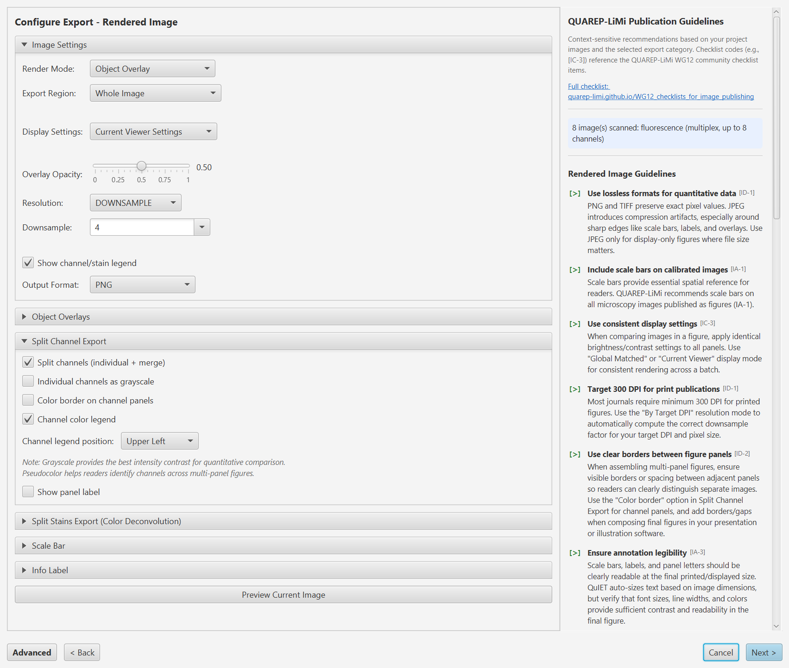
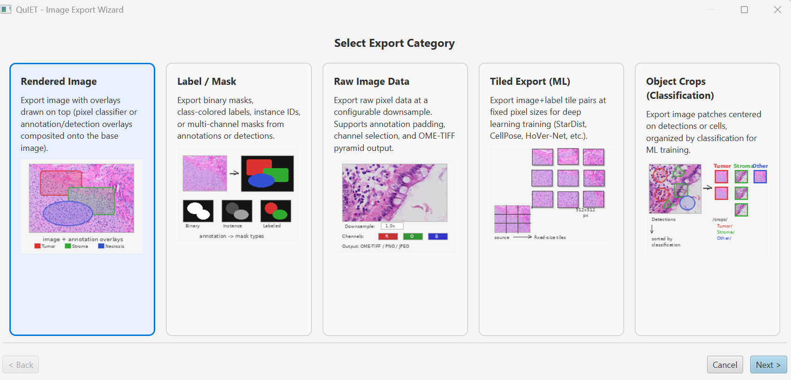
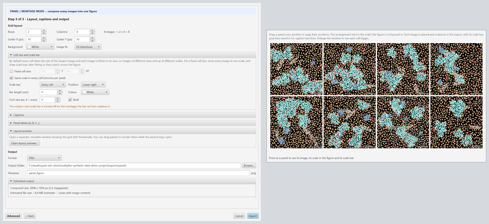

# QuIET - QuPath Image Export Toolkit

[](https://github.com/uw-loci/qupath-extension-image-export-toolkit/releases)
[](LICENSE)

A [QuPath](https://qupath.github.io/) extension that turns annotated whole-slide images into **publication-ready figures**, **review images for collaborators**, and **training datasets for machine learning** -- in batch, without writing an export script.

A guided wizard walks you from "I have an annotated project" to finished files: composite figures with scale bars and panel labels, segmentation masks for training or QC, raw pixel data at any resolution, image+label tile pairs for deep-learning frameworks, per-object crops for cell-type classifiers, and multi-image panel figures that arrange many project images into a single montage. Every single-image export also writes a self-contained Groovy script, so the same settings can be re-run, version-controlled, or shared with a collaborator who doesn't have QuIET installed (see *Script Generation* for what a script does not reproduce).

<!-- TODO(v1.0.0 docs): regenerate QUIET-interface.png and RenderedImageExport.png on a
     running QuPath with the v1.0.0 jar. The Step 1 category picker shows five cards
     (Rendered, Mask, Raw, Tiled, Object Crops); Panel / Montage is a separate menu
     item with its own wizard, not a card here. -->


<div align="center">

↓ &nbsp; *e.g.* &nbsp; ↓

</div>



## Requirements

- **QuPath 0.7.0** or later
- Java 21+

## Installation

### From the catalog (recommended)

Updates are offered there too.

1. In QuPath, open `Extensions > Manage extensions > Manage extension catalogs > Add catalog` and add `https://github.com/uw-loci/qupath-catalog-mikenelson` (LOCI QuPath Extensions).
2. In **Manage extensions**, install **QuIET - Image Export Toolkit**.
3. Restart QuPath.

### By hand

1. Download the latest `qupath-extension-image-export-toolkit-*-all.jar` from [Releases](https://github.com/uw-loci/qupath-extension-image-export-toolkit/releases)
2. Drag the JAR onto the running QuPath window, **or** copy it into your QuPath `extensions/` directory
3. Restart QuPath

The extension appears under **Extensions > QuIET**, with two menu items: **Image Export...** and **Panel / Montage Export...**

> Both menu items are disabled until a project with at least one image is open.

## Quick Start

1. Open a QuPath project containing annotated images
2. Go to **Extensions > QuIET > Image Export...**
3. **Step 1** -- Choose an export category. There are **five** categories: Rendered, Mask, Raw, Tiled, and Object Crops.



4. **Step 2** -- Configure export settings (grouped into collapsible sections). A QUAREP-LiMi guidelines panel on the right provides context-sensitive recommendations based on your project's images.
5. **Step 3** -- Select images, choose output directory, review Publication Advice, and click **Export**

When the export finishes, the bottom of the wizard reads `Exported N images.` and the output folder (`exports/<category>` inside the project, unless you chose another) opens in your file browser. It holds the exported files and a metadata file (`export_info.txt`, or `mask_legend.txt` for masks).

All five categories use this **3-step** flow. Composing a multi-image figure is a separate **Extensions > QuIET > Panel / Montage Export...** menu item with its own **3-step** flow -- see *Making a panel figure* below.

Every single-image export also generates a **Groovy script** that you can copy, save, and re-run from QuPath's built-in script editor -- no extension required. **Copy Script** and **Save Script...** are on the last step in Advanced mode.

**Simple vs Advanced mode** -- the navigation bar has a Simple / Advanced toggle. Simple mode (the default on first run) hides rarely-used controls to reduce clutter; Advanced mode exposes every option. Hidden controls keep their values, and those values still apply to the export. The toggle persists across QuPath sessions and applies to every step. If a section below seems to be missing settings, flip to Advanced.

**Making a panel figure** -- The **Panel / Montage Export...** menu item builds one combined figure from several images in your project. It opens its own wizard with a **3-step** flow: (1) select the images you want in the figure, (2) choose a *recipe* -- a recipe is the saved settings for how one image is exported, and the same recipe is applied to every image you picked -- and (3) lay out the grid (rows and columns, spacing, background color, optional captions). QuIET renders every image the same way and tiles them into one file. You do not need to export each image separately or assemble the figure by hand in another program. See the **Panel / Montage** section below.

---

## What's new

**v1.4.2** -- Panel / Montage and wizard fixes from a real figure run:
- A panel cell honors the recipe's annotation region: it shows the bounding box of the image's matching annotations instead of the whole image. Before, a Tissue-rectangle recipe gave whole slides shrunk to about 1/65 scale.
- **Add to Workflow** is shown in panel mode and is respected. Unticked, a panel export leaves the source images untouched; before, it always recorded a workflow step and saved every source image.
- **Global Matched** works in a panel recipe: ranges are matched over the panel's images, per kind of image. Before, each cell used its own default display.
- The output format is no longer switched to SVG by a render-mode change once you have picked a format, and the **Annotation Classes** box keeps your ticks when the page is laid out again.

**v1.4.1** -- Copied scripts work on the images you selected, and Global Matched keeps image types apart:
- **Copy Script**, **Save Script...** and the workflow-history script now list the images you selected and work on those, in that order, instead of on every image in the project. A pre-scan in the script (Global Matched display ranges, a shared map range) therefore covers the same images as the wizard. Emptying the list in the script brings back the old whole-project behavior.
- **Global Matched** matches each kind of image separately. Images with the same pixel type and channel names (for example 8-bit RGB brightfield, or 16-bit single-channel birefringence) share one range per channel, and each kind gets its own. Before, every image went into one histogram sized from the first image. A 16-bit image exported after an 8-bit one lost every value above 255.
- `export_info.txt` lists the matched range of each kind of image.

**v1.4.0** -- Map files placed where their grid belongs:
- A map file whose description has a `Placement:` line, as Fiber Analysis now writes, is placed on the image where that line says its grid sits, instead of being stretched over the whole image. Its edges no longer drift by up to one analysis window. Image pixels outside the grid stay uncovered. A map made for an image of a different size is skipped and named.
- Every map is drawn at the export's resolution. A map marked `nearest` keeps its blocky cells, and a `bilinear` one blends values between cell centers by the same rule as Fiber Analysis's own overlay.
- An angle channel (`axial=180` in the file) is blended as an angle and drawn from 0 to 180, and picking it selects the **Angle (cyclic)** colormap.
- A classifier's *Predicted class index* channel is drawn in each class's color, with a class legend.
- **Hide values at or below the minimum** leaves the background of a map transparent.
- When the selected images' maps were cut at different thresholds, QuIET says so before exporting.

**v1.3.1** -- Fixes found in a documentation review:
- Skipped images are named when an export ends, not only counted.
- `export_info.txt` writes a map's color range in full, with a decimal point in every language, and names the QuIET and QuPath versions, as do the generated scripts.
- A Panel / Montage records its map overlay and range in `panel_figure_info.txt`, and that file now gives the right QuIET version.
- Global Matched display ranges are recorded in `export_info.txt`.
- In Simple mode, the overlay source, its opacity and the map's color scale bar stay visible when the render mode needs them.
- Publication Advice updates as you tick and untick images.
- Raw export's channel list is filled in, so channels can be left out.

**v1.3.0** -- **Density / Map Overlay** can draw a map file per image (for example density or probability maps written by another program), found by a file pattern. Every map overlay, including QuPath's own density maps, can share one color range across images, and the color scale bar takes a title. See *Density / Map Overlay* under Rendered Image.

**v1.0.0** -- **Panel / Montage export** -- QuIET can now compose many images from your project into a single multi-panel figure. Choose your images, pick a single-image export recipe to apply to all of them, set the grid size, spacing, background color, and optional per-image captions, and QuIET writes one montage file. See the **Panel / Montage** section below.

**Export recipes** (v1.0.0) -- A recipe is the saved settings for how one image is exported. Any panel-mode recipe configuration can now be saved to a `.json` recipe file and reloaded later -- to repeat a panel export with identical settings, or to share the look of a figure with a collaborator. Look for the **Save recipe...** and **Load recipe...** buttons on the panel recipe step.

v1.0.0 was QuIET's first 1.x release, a maturity milestone for a major new feature; **no existing settings, menus, or exports changed** -- see *Migrating from v0.7.x to v1.0.0* below.

<details>
<summary><strong>Migrating from v0.7.x to v1.0.0</strong></summary>

v1.0.0 is a **fully backward-compatible** release. The version jump marks the arrival of the Panel / Montage export feature, not a breaking change.

- **Your preferences keep working.** All existing settings (export category, downsample, format, mask type, label templates, and so on) are preserved. Panel export adds new `quiet.panel.*` preferences; no existing preference key is renamed or removed.
- **Your projects are unaffected.** Panel export only reads images and metadata; it never modifies the QuPath project.
- **The existing flows are unchanged.** Rendered, Mask, Raw, Tiled, and Object Crops still run from the **Image Export...** menu item (renamed from "Export Images...") with the same 3-step wizard. Panel / Montage is added as a separate **Panel / Montage Export...** menu item with its own wizard.
- **Existing Groovy scripts still run.** Scripts generated by earlier QuIET versions are unaffected.

Install the v1.0.0 jar over the old one and restart QuPath.

</details>

---

<details>
<summary><h2>Publication-Quality Image Guidelines</h2></summary>

QuIET was developed in support of the community-developed checklists for publishing
images and image analyses
([Schmied et al., 2023, *Nature Methods*](https://doi.org/10.1038/s41592-023-01987-9)),
created by the [QUAREP-LiMi](https://quarep.org/) initiative. These checklists provide
consensus guidelines on image formatting, colors, annotation, and data availability
for microscopy publications.

QuIET's guidelines panel references specific checklist items from the
[QUAREP-LiMi WG12 interactive checklists](https://quarep-limi.github.io/WG12_checklists_for_image_publishing/intro.html),
organized into four categories:

- **Image Format** (ID-1 through ID-5): Cropping, borders, insets, phenotype range
- **Image Colors & Channels** (IC-1 through IC-9): Channel annotation, brightness/contrast, color-blind accessibility, grayscale panels, intensity calibration bars
- **Image Annotation** (IA-1 through IA-5): Scale bars, annotation explanation, legibility, data visibility, imaging details
- **Image Availability** (Avail-1 through Avail-3): Lossless sharing, public repositories, dedicated databases

Each guideline item in QuIET's panel shows its QUAREP checklist code (e.g., `[IC-6]`)
so users can cross-reference the full guidance at the WG12 website.

Inspiration for QuIET's approach to automated image quality guidance also comes from
Jan Brocher's [BioVoxxel Figure Tools](https://github.com/biovoxxel/BioVoxxel-Figure-Tools)
plugin for Fiji/ImageJ, which provides interactive tools for creating
publication-ready figure panels with colorblind-friendly LUT options and CDV
(color deficient vision) simulation.

QuIET integrates QUAREP-LiMi guidance at two levels:

**QUAREP Guidelines Panel (Step 2)** -- A context-sensitive panel shown alongside
the export configuration that scans your project images and provides proactive
recommendations based on the detected image types (brightfield, fluorescence,
multiplex). The panel displays relevant advice for each export category, including:

- Channel color analysis with colorblind-accessibility warnings
- Annotation/overlay color contrast recommendations
- Split-channel and display settings guidance for fluorescence
- Scale bar color and format recommendations
- Category-specific best practices (masks, tiled ML, raw, object crops)

**Publication Advice Dialog (Step 3)** -- A floating modeless dialog that checks
your specific export configuration against key QUAREP-LiMi recommendations:

- Missing scale bars on calibrated images
- Lossy JPEG compression for quantitative data
- Inconsistent display settings across compared images
- Red-green channel combinations that are not colorblind-accessible
- Multi-channel images without individual grayscale channel panels
- Missing pixel calibration for spatial reference

Each advice item identifies the specific config section to fix (e.g., "-> Scale Bar
section"). When you navigate back to Step 2, those sections are highlighted with
colored borders matching the advice severity, so you can find and fix the issue
without memorizing the advice.

All checks are advisory -- QuIET will never block an export, but helps researchers
produce clearer, more reproducible microscopy figures.

</details>

---

## Export Categories

<details>
<summary><h3>Rendered Image</h3></summary>

Produce **publication-ready figures** -- the image as it looks in QuPath, with your annotations, classifier results, or density map composited on top. Add a scale bar, panel letter (A, B, C...), per-image info stamp, and split multi-channel fluorescence into individual + merged panels in one batch. This is the export you want for papers, posters, slide decks, and figures shared for review.


| Option | Description |
|--------|-------------|
| **None** (default) | Export the base image with no overlay source; objects, scale bar and labels can still be added. The **Render Mode** dropdown is ringed in blue until you open it, as a reminder that this is where overlays are chosen |
| **Classifier Overlay** | Render a pixel classifier's output on top of the image at configurable opacity |
| **Object Overlay** | Render annotation and/or detection objects with fill, outline, and name options |
| **Density / Map Overlay** | Color a map with a colormap (Viridis, Magma, etc.) and draw it over the image: a density map saved in the project, or a map file per image written by another tool (density, probability or measurement maps). One color range can be shared by every image (see below) |
| **Export Region** | Export the whole image or one image per annotation (see below) |
| **Overlay Opacity** | How much a classifier or map overlay covers the image, 0 to 1 (default 0.5) |
| **Display Settings** | Control brightness/contrast, channel visibility, and LUTs applied to the base image (see below) |
| **Scale Bar** | Optionally burn a scale bar into the exported image with configurable position and color (see below) |
| **Color Scale Bar** | For map overlays, optionally burn a color-mapped legend with its value labels and a title (see below) |
| **Panel Label** | Optionally add a letter label (A, B, C...) for multi-panel publication figures (see below) |
| **Info Label** | Optionally add a per-image metadata text stamp with template placeholders (see below) |
| **Split Channels** | Export multi-channel images as individual channel panels plus a merged panel, with optional grayscale/pseudocolor rendering, channel border colors, and a channel/stain legend swatch (see below) |
| **Downsample** | Resolution factor (1x = full resolution, 4x = quarter, etc.) |
| **Format** | PNG, TIFF, JPEG, OME-TIFF, OME-TIFF Pyramid, SVG |

**Preview Current Image** renders the open image with the current settings in a separate window. While that window is open it updates as you change any setting -- scale bar, panel and info labels, color legend, display settings, overlays -- usually within a second, so you can place and size labels without clicking Preview again. A line under the image says *Updating...* while it redraws. The preview of a split-channel export shows the first visible channel; the preview of an annotation-region export shows the first matching annotation.

<details>
<summary><b>Density / Map Overlay</b></summary>

Draws a map of values over each image, in color. With **Render Mode** (in **Image Settings**) set to **Density / Map Overlay**, the **Overlay Source** and **Color Scale Bar** sections appear, in Simple mode too.

![The Configure Export screen in Simple mode for a map overlay: Render Mode set to Density / Map Overlay with Overlay Opacity 1.00; Overlay Source with Map Source set to Map file per image, the Fiber Analysis density-map pattern in Map File and the Check result below it (574 x 429, 11 channels, float32), Map Channel set to Signal density (no threshold), Colormap/LUT Viridis, Color Range Shared with Percentiles 1 to 99, Hide values at or below the minimum unticked; Color Scale Bar ticked, in the upper right, with the title filled in from the channel as Signal density (no threshold) (fraction of full scale)](documentation/images/map-overlay-settings.png)

| Map Source | What it reads |
|------------|---------------|
| **Project density map** | A density map saved in the project (**Analyze > Density maps > Create density map...**), computed from each image's objects. QuIET draws its first channel. A density map carries no unit, so type one into the color scale bar **Title** if you want it shown. |
| **Map file per image** | One image file per project image, holding the values to color: a density map, a probability map, a measurement map, or any OME-TIFF of decimal (floating-point) values. QuIET does not need to know which program wrote it. The development version of Fiber Analysis writes such maps; no Fiber Analysis release does yet. |

The controls, in screen order:

| Control | Default | What it does |
|---------|---------|--------------|
| **Map Source** | Project density map | Where the map comes from (above) |
| **Density Map** | -- | Which saved density map (Project density map only) |
| **Map File** and **Check** | blank | The file pattern (below). **Check** finds the open image's map file |
| **Map Channel** | the first channel | The channel to color, chosen by name |
| **Colormap/LUT** | Viridis | The colors from low to high. Viridis, Magma, Plasma and Inferno change evenly in brightness and stay readable with common color blindness |
| **Color Range** | Each image: its own min to max | How values are given colors (see *Color range*) |
| **Min / Max** | 0 / 1 | The values given the first and last color (Fixed only). Max must be greater than Min |
| **Percentiles** | 1 / 99 | Which pooled values set the range (Shared only); 0 to 100 in steps of 0.5, the upper greater than the lower |
| **Hide values at or below the minimum** | off | Leaves values at or below the range's lower end uncovered instead of giving them the first color, so the image shows through. A background of exactly 0 with a minimum of 0 is the usual case |
| **Overlay Opacity** (in Image Settings) | 0.5 | How much the map covers the image (see *Comparing colors between images*) |

**Finding each image's map file.** The **Map File** box takes a file path with placeholders in braces, which QuIET fills in for each image:

| Placeholder | Becomes | For `slide 1.ome.tif` in a project at `D:/study` |
|-------------|---------|------------------------------------------------|
| `{project}` | The project folder | `D:/study` |
| `{imageDir}` | The folder holding the image file | the image's own folder |
| `{image}` | The image name in the project | `slide 1.ome.tif` |
| `{imageBase}` | The image name without its last extension (QuPath's rule, which treats `.ome.tif` as one extension) | `slide 1` |
| `{imageSafe}` | The image name with each run of `\ / : * ? " < >`, `\|` or white space replaced by `_`, and trailing dots removed. The extension stays | `slide_1.ome.tif` |

Add `:N` to cut a placeholder to N characters: `{imageSafe:5}` gives `slide`. A path that does not start at a drive or at `/` is looked up inside the project folder. In the file name (not in folder names), `*` stands for any run of characters and `?` for any one character. Exactly one file must match; when none or more than one does, that image counts as having no map file.

The **Map File** box offers four examples:

| Pattern | Use it when |
|---------|-------------|
| `{imageDir}/{imageBase}_map.ome.tif` | The maps sit next to the images: `slide1.svs` has `slide1_map.ome.tif` |
| `{project}/maps/{imageSafe}.ome.tif` | The maps are in a `maps` folder inside the project |
| `{project}/fiber-analysis/density-maps/{imageSafe:60}_density.ome.tif` | Fiber Analysis density maps (development version): `slide_1.ome.tif_density.ome.tif`. Fiber Analysis cuts the name to 60 characters before adding `_density`, which `:60` matches |
| `{project}/fiber-analysis/classifier-maps/{imageSafe:60}_*.ome.tif` | Fiber Analysis window-classifier maps, while one classifier has been applied to each image. With two, `*` matches both files: replace it with the model's part of the file name |

**Check** finds the open image's map file and reports it under the box, for example `Open image: slide_1.ome.tif_density.ome.tif (574 x 429, 11 channels, float32)`, then fills **Map Channel** with the file's channel names. The same channel name is used for every image. Two kinds of channel are drawn differently, and a note under **Map Channel** says when one is picked:

- **An angle**, marked `axial=180` in the map file (Fiber Analysis marks *Mean angle (deg)* this way). Orientations of 1 and 179 degrees are 2 degrees apart, so the channel is blended as an angle and colored from 0 to 180 unless **Color Range** is **Fixed**: a per-image or percentile range would turn the color wheel between images. Picking the channel selects **Fixed**, 0 to 180, and the **Angle (cyclic)** colormap when one is installed (Fiber Analysis installs it).
- **A class index**, a channel named *... class index* in a map that also holds one `P(<class>)` channel per class, as a Fiber Analysis window classifier writes. Each whole number is drawn in that class's QuPath color. A NaN (the model abstained), or a number that names no class, is left uncovered. The channel is never blended, and the color scale bar becomes a legend of the classes.

**Where the map is drawn.** A map file can say where it belongs. When its image description has a line such as

```
Placement: source_width=16952; source_height=18225; source_pixel_um=0.1732; cell_px=36; window_px=144; x0=54; y0=54; grid=467x503; render=bilinear
```

each map pixel is one cell of a grid on the image: pixel (i, j) covers image pixels `x0 + i*cell_px` to `x0 + (i+1)*cell_px` across, and the same down. The grid can stop short of the image's edges: in this Fiber Analysis map it starts 54 pixels in from the top-left corner and ends 86 pixels short of the right edge and 63 short of the bottom. Image pixels outside the grid have no value and stay uncovered. If `source_width` and `source_height` are not exactly the image's size, the map was made for another image, and the image is skipped. A map without a `Placement:` line must cover the whole image, its top-left corner at the image's top-left, and QuIET stretches it to the image's width and height. A map of a different shape is stretched anyway (the log warns when the shapes differ by more than 2%), and a map made for a crop of the image lands in the wrong place.

**How the map is drawn.** Every exported pixel takes its value from the map at that pixel's center, so a map is exact at any downsample. With `render=nearest` each cell is filled with its value, and coarse cells stay blocky. With `render=bilinear`, and for every map without a `Placement:` line, values are blended between the four nearest cell centers before coloring. Cells with no value are left out of the blend and the other weights scaled up, and beyond the outermost centers the edge value continues. Fiber Analysis's own overlay computes its values the same way. Pixels with no value (NaN), such as glass outside the tissue, are transparent. Values outside the color range, infinities included, take the end colors. A map too large to read with all its channels at once (over 128 MB) is read in strips of rows, so an 11-channel full-resolution map never has to be in memory whole.

**Color range.** This decides which value gets which color, and so whether colors can be compared between images:

| Color Range | Effect |
|-------------|--------|
| **Each image: its own min to max** (default, and how earlier versions drew every density map) | Every image, or annotation region, is stretched to the minimum and maximum of the map cells under it. The same color then means different values in different images, so do not use it to compare images. |
| **Fixed: the same values for every image** | The **Min / Max** you enter, for every image. Use it when the map's values have a known scale, or to repeat an earlier export. |
| **Shared: percentiles of all exported images** | Before exporting, QuIET reads the map of every selected image and takes the two **Percentiles** of their values. With 1 to 99, the lowest and highest 1% of values take the end colors, so a few extreme pixels do not stretch the scale. Every image is drawn on that one range. |

*How the Shared range is computed.* The values are a sample. Each image's map is read over the whole image (in an annotation-region export too), at the export downsample or coarser, and never larger than 4096 pixels on its longest side. Each image then adds at most 2,000,000 / *N* of its values (for *N* images, and at least 10,000), thinned evenly, so each image counts about equally however large it is. Percentiles interpolate between sorted values, as NumPy's `percentile` does by default. Nothing random is involved, so the same images and settings give the same range; changing the selected images, or the downsample for images smaller than 4096 pixels times the downsample, changes it. 0 to 100 gives the minimum and maximum of the sample, so a few full-resolution pixels can still fall outside. The preview computes its range from the open image alone, so its color scale bar can differ from the export's.

**Comparing colors between images.** A shared or fixed range makes one color stand for one value. What you see, though, is the map blended with the image under it at **Overlay Opacity** (default 0.5), while the color scale bar is drawn fully opaque. To compare values by color, set **Overlay Opacity** to 1.


**What is recorded.** `export_info.txt` beside the images holds a *Map Overlay* block; for a Panel / Montage the same block is in `panel_figure_info.txt`. Fixed and shared ranges are written in full, with a decimal point whatever your system's language, so they can be pasted into a script. With **Each image** the block says so but holds no numbers: the color scale bar on each image shows them. From a real export:

```
Map Overlay
-----------
Source: map file per image, pattern ../maps/{imageSafe}_density.ome.tif
Channel: Signal density
Color map: Viridis
Color range: 0.02010050229728222 to 0.6000000238418579, the 0 to 100 percentile of the values of all exported images
Overlay opacity: 1
Values outside the range take the end colors; pixels with no value are transparent.
```

**Images without a map.** Before the export starts, QuIET looks for every selected image's map file. If some have none, a **QuIET - Missing Map Files** window lists them (`1 of 4 selected images have no map file and will be skipped: ... Continue?`). If you go on, those images are skipped, never exported without their overlay, and named again in **QuIET - Some Images Skipped** when the export ends. If none of the selected images has a map file, the export does not start. An image whose map was made for an image of another size, or lacks the chosen channel, is skipped when the export reaches it and named in the same window.

**Maps cut at different thresholds.** A map file can record the threshold its values were cut at, in a line such as `Threshold: Otsu 0.07800 | Otsu pooled over 1 image(s), ... | settings 7a3ec246 at 0.1732 um/px` (Fiber Analysis writes one). When the selected images' maps record different cuts, different settings, or pixel sizes more than 2% apart, their values do not measure the same thing. **QuIET - Maps Not Comparable** then lists each group of images and asks whether to go on. How each cut was obtained does not matter; maps without the line are left out of the comparison.

**Generated script.** The Groovy script finds the files with the same pattern and reads the same channel. For a shared range it scans the images you selected before exporting. It prints `Map range for all images: <min> to <max>`, then `SKIP: <reason>` for each image without a map, and ends with a line such as `Export complete: 3 succeeded, 0 failed, 1 skipped (no usable map)`. It places, blends and colors each map as QuIET does, so its images match QuIET's pixel for pixel. If you edit the script's image list, it computes its own shared range from the images it then lists. To repeat an earlier export exactly, set the range by hand, with the numbers from that export's `export_info.txt`:

```groovy
def mapRangeMode = "FIXED"
def mapRangeMin = 0.02010050229728222d
def mapRangeMax = 0.6000000238418579d
```

The other map settings in the script are `mapSource`, `densityMapName`, `mapFilePattern`, `mapChannel`, `mapLowPercentile`, `mapHighPercentile`, `mapHideAtOrBelowMin`, `colorScaleBarTitle` and `overlayOpacity`.

#### If Check reports a problem

| Under Map File | Cause | Fix |
|----------------|-------|-----|
| `Open image: no map file <path>` | No file at that path. Often `{imageBase}` was used where the program kept the extension in the name | Compare the path shown with the real file name. Switch between `{imageBase}` and `{imageSafe}`, or add `:60` |
| `Open image: 2 map files match <path> ...; make the pattern more specific` | A wildcard matched several files | Replace `*` with the part of the name that tells the files apart |
| `Open image: unknown token {imagename}; use {project}, {imageDir}, {image}, {imageBase} or {imageSafe}` | A misspelled placeholder; they are case-sensitive | Use the exact spelling |
| `Open image: wildcards are allowed only in the file name, not in folders: ...` | A `*` or `?` in a folder name | Write the folder name in full |
| `Open an image to check which file the pattern finds.` | No image is open | Open a project image, then **Check** |

An image whose map lacks the chosen channel is skipped with `the map has no channel '<name>' (it has ...)`: that map was written with different channel names. An image whose map was made for another image is skipped with `<map file>: the map was made for a 16952 x 18225 image but this image is 16952 x 18224`.

</details>

<details>
<summary><b>Display Settings</b></summary>

By default, rendered exports apply per-image brightness/contrast and channel visibility settings -- so fluorescence images look like they do in the QuPath viewer instead of appearing as raw pixel data.

| Mode | Description |
|------|-------------|
| **Per-Image Saved Settings** (default) | Each image uses its own saved display settings from the QuPath project. If you used "Apply to similar images" in the B&C dialog, all images will already share the same settings. Changes made in Brightness & Contrast reach the export only after the image is saved (**File > Save**); to export exactly what is on screen without saving, use **Current Viewer Settings**. |
| **Current Viewer Settings** | Captures the display settings from the currently open image and applies them uniformly to all exported images. Requires an image to be open. |
| **Saved Preset** | Loads a named B&C preset saved in the project (via the Brightness & Contrast dialog's save button) and applies it to all images. |
| **Global Matched (batch)** | Before exporting, reads every image being exported at 1/32 size and sets one display minimum and maximum per channel for each kind of image, leaving out **Saturation (%)** of the values at each end (default 0.1, up to 5). A kind is a pixel type plus channel names, so 8-bit RGB images and 16-bit single-channel images in one export each get their own ranges. Within a kind, the same pixel value then looks the same in every image, so use it for images readers will compare. Channel colors come from the first image of each kind. The generated script lists the selected images and matches them the same way. |
| **Raw (No Adjustments)** | Exports raw pixel data with no display transforms. This was the only behavior prior to v0.2.1. |

`export_info.txt` records the minimum and maximum used for each channel with **Current Viewer Settings**, **Saved Preset** and **Global Matched**. With **Per-Image Saved Settings** it records only that each image used its own, and a generated script reads them again when it runs, so prefer Global Matched or Current Viewer Settings for a figure you will publish.

</details>

<details>
<summary><b>Annotation Region Export</b></summary>

Instead of exporting the whole image, you can export individual annotation regions as separate cropped panels -- ideal for publication figures showing specific tissue features.

| Option | Values |
|--------|--------|
| **Export Region** | Whole Image (default), One Image Per Annotation |
| **Padding (pixels)** | Pixel padding around each annotation's bounding box (default: 0) |

When **One Image Per Annotation** is selected, each annotation's bounding box is exported as a separate image file, with all overlays (classifier, objects, density map, scale bar, panel label) applied to the cropped region. Padding is clamped to image bounds.

</details>

<details>
<summary><b>Scale Bar</b></summary>

Rendered exports can optionally include a burned-in scale bar with text label. The scale bar automatically picks a "nice" length (e.g., 50 µm, 200 µm, 1 mm) targeting roughly 15% of the image width, and formats the label with appropriate units.

| Option | Values |
|--------|--------|
| **Show scale bar** | Enable/disable (default: off) |
| **Position** | Lower Right (default), Lower Left, Upper Right, Upper Left |
| **Color** | Any hex color via color picker -- **smart default** auto-detected from project images (black for brightfield, white for fluorescence). Drawn with a luminance-based contrast outline for visibility on any background. |
| **Font size** | Auto (computed from image dimensions) or explicit size in points |
| **Bold text** | Enable/disable (default: on) |
| **Background box** | Draw a semi-transparent contrasting box behind the scale bar and label (default: off). Recommended for highly multiplexed fluorescence images where the scale bar may overlap bright signal regions. |

The scale bar color is auto-detected from your project's images when the wizard opens for the first time: brightfield-dominant projects default to black (for contrast against white tissue backgrounds), and fluorescence projects default to white (for contrast against dark backgrounds). A hint label below the color picker reminds you to choose high contrast with the image background.

The scale bar requires pixel calibration in the image metadata. If an image has no calibration, the scale bar is skipped with a warning.

> **Note:** Scale bars are only available for rendered exports. Mask, raw, and tiled exports preserve exact pixel values and must not be modified.

</details>

<details>
<summary><b>Color Scale Bar</b></summary>

For map overlays, a color-mapped legend can be burned in showing the value range with five value labels and a gradient swatch matching the selected colormap.

| Option | Values |
|--------|--------|
| **Show color scale bar** | Enable/disable (default: off) |
| **Position** | Lower Right (default), Lower Left, Upper Right, Upper Left |
| **Title** | Text drawn under the bar (above it when the bar is in a lower corner), such as the measurement and its unit; blank for none. With **Map file per image**, picking a **Map Channel** fills it in from the channel name, plus the channel's unit when the map file records one (`Signal density (no threshold)` with unit `fraction of full scale` becomes `Signal density (no threshold) (fraction of full scale)`). A title you typed yourself is kept. |
| **Font size** | Auto (computed from image dimensions) or explicit size in points |
| **Bold text** | Enable/disable (default: on) |

The five labels are the range's minimum, quartiles and maximum, rounded to 2 decimals (values below 0.01 in scientific notation). With a fixed or shared range, pixels beyond either end take the end color, so the top label means "this value or more". The color scale bar is only available with Render Mode **Density / Map Overlay**.

For tools that write map files, QuIET reads these from the TIFF's image description (classic TIFF or BigTIFF):

- a channel's unit, from a row `[index] name=...; unit=...`;
- an angle channel, from `; axial=P` on its row (P is the period, 180 for an orientation in degrees);
- where the grid sits, from a `Placement:` line (see *Where the map is drawn*);
- the threshold, from a `Threshold:` line (see *Maps cut at different thresholds*).

A channel named *... class index* is drawn in class colors when the map also has `P(<class>)` channels, whose names give the classes in channel order.

</details>

<details>
<summary><b>Panel Labels</b></summary>

Add automatic letter labels (A, B, C, ...) to exported images for multi-panel publication figures.

| Option | Values |
|--------|--------|
| **Show panel label** | Enable/disable (default: off) |
| **Label text** | Fixed text (e.g., "A") or leave blank for auto-increment (A, B, C... per image in batch) |
| **Position** | Upper Left (default), Upper Right, Lower Left, Lower Right |
| **Font size** | Auto (computed from image dimensions) or explicit size in points |
| **Bold text** | Enable/disable (default: on) |

Panel labels are drawn with a luminance-based contrast outline for visibility on any background. In batch export with auto-increment, the first image receives "A", the second "B", and so on (extending to "AA", "AB"... after "Z").

</details>

<details>
<summary><b>Info Label</b></summary>

Add a per-image metadata text stamp to exported images. The template is resolved per-image at export time, so each image gets its own metadata values.

| Option | Values |
|--------|--------|
| **Show info label** | Enable/disable (default: off) |
| **Template** | Text with `{placeholder}` tokens (see below) |
| **Position** | Lower Left (default), Lower Right, Upper Left, Upper Right |
| **Font size** | Auto (computed from image dimensions) or explicit size in points |
| **Bold text** | Enable/disable (default: off) |

**Available placeholders:**

| Placeholder | Resolves to |
|-------------|-------------|
| `{imageName}` | The project image entry name |
| `{pixelSize}` | Pixel calibration (e.g., "0.500 µm/px") or "uncalibrated" |
| `{date}` | Current date (YYYY-MM-DD) |
| `{time}` | Current time (HH:MM) |
| `{classifier}` | Classifier name (empty if no classifier overlay selected) |
| `{width}` | Image width in pixels |
| `{height}` | Image height in pixels |

A **live preview** below the template field resolves the template against the currently open image and warns about empty or unrecognized placeholders. An inline placeholder reference is always visible (not hidden behind a tooltip).

</details>

<details>
<summary><b>Split Channels & Channel Legend</b></summary>

For multi-channel fluorescence images, the rendered export can emit one panel per channel plus a merged panel, which is the standard publication layout for multiplex data.

| Option | Values |
|--------|--------|
| **Split channels (individual + merge)** | Enable/disable. When on, each exported image produces one file per visible channel plus a merged file. |
| **Individual channels as grayscale** | Render each channel panel as grayscale (best intensity contrast for quantitative comparison). The channel's display minimum maps to black and its maximum to white, exactly as in the viewer's grayscale mode. |
| **Individual channels in pseudocolor** | Render each channel panel in its LUT color, with its display minimum and maximum, so it looks as it does in the viewer with only that channel on (helps readers identify channels across multi-panel figures). |
| **Color border on channel panels** | Draw a colored border around each channel panel matching that channel's LUT color. |
| **Channel color legend** | Draw a small colored rectangle with the channel name on each individual channel panel, so the channel is identifiable even in grayscale. |
| **Show channel/stain legend** | Draw a full channel/stain legend on the exported image (available for all rendered exports, not only split-channel). It lists the visible channels in their display colors. In a split-channel export the merged file gets the full legend and each channel file gets its own swatch. |

</details>

<details>
<summary><b>Split Stains (Color Deconvolution)</b></summary>

The brightfield equivalent of split channels. On a brightfield image with color-deconvolution stains set (Analyze -> *Estimate stain vectors* / *Set color deconvolution stains*), QuIET can write each deconvolved stain as its own image file: `imageName_Stain1_Hematoxylin.ext`, `imageName_Stain2_Eosin.ext`, and so on. Built on QuPath's `TransformedServerBuilder.deconvolveStains()`.

| Option | Values |
|--------|--------|
| **Split stains (color deconvolution)** | Enable/disable. When on, each exported image produces one file per stain (residual optional). |
| **Include residual stain** | Off by default. Turn on to also export the residual channel for QC of the stain estimation. |
| **Individual stains as grayscale** | Render each stain panel as grayscale (default, recommended for publications) or its stain pseudocolor. |
| **Color border on stain panels** | Draw a colored border around each stain panel matching that stain's pseudocolor. |
| **Stain color legend swatch** | Draw a small colored rectangle plus the stain name in the upper-left corner of each per-stain panel. |

**Mutually exclusive with Split channels.** Requires brightfield image type and stains set; images without stains are skipped with a warning. Settings are persisted under `quiet.rendered.splitStains*`.

</details>

</details>

<details>
<summary><h3>Label / Mask</h3></summary>

Generate **segmentation masks paired with your images** -- the ground-truth label files needed to train or evaluate segmentation models, or to review which objects QuPath has detected. Choose binary foreground/background, integer class labels, per-object instance IDs, class-colored overlays, or one binary channel per class. Masks are rendered exactly from your annotation geometry (no JPEG, no resampling artifacts), so label values stay precise at any resolution. (Built on QuPath's `LabeledImageServer`.)

| Mask Type | Description |
|-----------|-------------|
| **Binary** | Single-class foreground/background (label 0 and 1) |
| **Grayscale Labels** | Integer label per classification (1, 2, 3, ...) with optional grayscale LUT |
| **Class-Colored** | RGB mask using each class's color |
| **Instance IDs** | Unique integer per object instance (16-bit), with optional label shuffling for visual clarity |
| **Multi-Channel** | One binary channel per classification |

Additional mask options:

- **Object source** -- Annotations, Detections, or Cells
- **Background label** -- Configurable background value (default 0)
- **Boundary labels** -- Enable boundary erosion with configurable label value and line thickness
- **Classification filter** -- Select/deselect which classifications to include
- **Skip images without selected classes** -- Skip exporting images that contain no objects matching any of the selected classifications. Avoids a pile of empty masks when only some images in the project have the relevant classes.
- **Format** -- PNG, TIFF, OME-TIFF, OME-TIFF Pyramid (no JPEG -- lossy compression destroys label values)

> **Note:** JPEG is intentionally excluded from mask format options because lossy compression alters pixel values, which would corrupt the integer label encoding. Masks are rendered from vector geometries at the requested downsample, so label values are always exact regardless of resolution.

</details>

<details>
<summary><h3>Raw Pixel Data</h3></summary>

Export the **underlying image pixels** -- no overlays, no brightness/contrast adjustment, no scale bar burned in -- at full resolution or downsampled. Use this when a downstream tool (an ML pipeline, a different analysis package, an archive) needs the original pixel values, optionally cropped to annotations or restricted to specific channels. Multi-resolution OME-TIFF Pyramid output is supported for very large regions.

| Option | Description |
|--------|-------------|
| **Region type** | Whole image, selected annotations, or all annotations |
| **Annotation padding** | Add pixel padding around annotation bounding boxes (clamped to image bounds) |
| **Channel Selection** | Untick channels to leave them out (Advanced mode). The list shows the open image's channels, or the first project image's if none is open. Leaving a channel out of an RGB image writes the kept channels as 32-bit values (QuPath's channel extraction), with the same numbers |
| **OME-TIFF Pyramid** | Multi-resolution pyramidal output with configurable levels, tile size, and compression |
| **Downsample** | Resolution factor |
| **Format** | PNG, TIFF, JPEG, OME-TIFF, OME-TIFF Pyramid |

> **Note:** OME-TIFF Pyramid export uses `OMEPyramidWriter` from `qupath-extension-bioformats`. If that extension is not installed, QuIET falls back to flat OME-TIFF via `ImageWriterTools`.

</details>

<details>
<summary><h3>Tiled Export (ML Training)</h3></summary>

Generate **fixed-size image + label tile pairs** ready to feed into deep-learning training pipelines like StarDist, CellPose, or HoVer-Net. Pick a tile size, overlap, and resolution, optionally restrict tiles to annotated regions, and QuIET emits matched image and mask tiles (plus optional per-tile GeoJSON) -- replacing the custom tiling script you'd otherwise write against QuPath's `TileExporter` API.

| Option | Description |
|--------|-------------|
| **Tile size** | Width and height in pixels (e.g., 256, 512, 1024) |
| **Overlap** | Pixel overlap between adjacent tiles |
| **Downsample** | Resolution factor for tile extraction |
| **Image format** | Output format for image tiles |
| **Generate label mask tiles** | Optionally write a label mask tile alongside each image tile |
| **Label mask type** | Binary, Grayscale Labels, Instance, Colored, or Multi-Channel |
| **Parent Objects** | Restrict tiles to annotation regions, TMA cores, or export all |
| **Annotated tiles only** | Skip tiles that contain no annotated objects |
| **Export GeoJSON per tile** | Export object geometries for each tile |

</details>

<details>
<summary><h3>Object Crops (Classification Training)</h3></summary>

Export **one small image per detected object**, organized by class, for training a per-object classifier (cell types, detection-quality filters, mitosis classifiers, etc.). Pick a fixed crop size around each cell or detection centroid, choose how classes should be encoded (subdirectory per class, or filename prefix), and QuIET produces a directory tree that drops directly into PyTorch / TensorFlow `ImageFolder`-style loaders.

| Option | Description |
|--------|-------------|
| **Object type** | Detections, Cells, Annotations, or All (Detections + Cells) |
| **Crop size** | Fixed output size in pixels (e.g., 64x64) |
| **Padding** | Extra pixels around the object centroid |
| **Downsample** | Resolution factor for crop extraction |
| **Label format** | Organize by subdirectory per class, or filename prefix |
| **Classification filter** | Select/deselect which classifications to export |
| **Format** | PNG, TIFF, JPEG |

Output structure depends on the label format:

- **Subdirectory**: `crops/ClassName/image_obj001.png`
- **Filename prefix**: `crops/ClassName_image_obj001.png`

</details>

<details>
<summary><h3>Panel / Montage</h3></summary>

Compose **many project images into one multi-panel figure**. Instead of exporting each image to its own file, Panel / Montage renders a set of selected images with a single shared **export recipe**, then tiles them into one rows-by-columns montage with controllable spacing, an optional per-image caption, and a chosen background color. This is the export for a figure that compares conditions, timepoints, or samples side by side -- replacing the manual "export each image, then assemble in Illustrator or ImageJ" step.

> A **recipe** is the saved settings for how one image is exported. In panel mode you choose the recipe once, and QuIET applies it to every image in the figure so all panels are rendered the same way.

Panel / Montage has its own menu item -- **Extensions > QuIET > Panel / Montage Export...** -- which opens a dedicated wizard with a **3-step** flow:

1. **Step 1 -- Select images.** Choose which project images go into the figure. Image selection comes *before* the layout on purpose -- the grid size is suggested from how many images you pick.
2. **Step 2 -- Recipe.** Choose how a single image should be exported. The recipe can be any of QuIET's single-image categories (Rendered, Raw, Mask); the same recipe is applied to every image. You can accept the pre-filled settings and continue, or adjust them. Optionally **Save recipe...** to a `.json` file, or **Load recipe...** to reuse one.
3. **Step 3 -- Layout, captions and output.** Set the grid (rows x columns), the gutter spacing, the background color, the cell-fit mode and optional captions, then choose the output format and export. Click **Open layout preview...** for a separate, resizable, always-on-top window that shows the montage with thumbnails -- drag any image onto another to swap their positions and rearrange the figure.



The first time you open Panel / Montage Export, a short one-time introduction explains how recipes work; you can dismiss it permanently with "Do not show this message again."

<details>
<summary><strong>Getting started</strong> (read this first)</summary>

**What panel export does** -- Panel / Montage produces *one* combined montage figure from *many* project images, instead of one file per image. It reads images and metadata. It changes the project only when **Add to Workflow** is ticked on Step 1: it then records a "Panel / Montage Export" step in every source image's workflow history, which saves each image's data file (its objects are written back unchanged).

**Prerequisites** -- an open QuPath project with at least two images, and the images you want in the figure already present in that project.

**First run** -- open **Extensions > QuIET > Panel / Montage Export...** and follow the step order: pick images, then choose a recipe, then set the grid. The grid controls (rows and columns) only appear on Step 3, after images are selected -- this is deliberate, not a bug. QuIET seeds the grid to a near-square layout for your image count, which you can then adjust.

QuIET's panel/montage layout follows conventions established by figure-assembly tools for microscopy: Jan Brocher's [BioVoxxel Figure Tools](https://github.com/biovoxxel/BioVoxxel-Figure-Tools), [QuickFigures](https://github.com/grishkam/QuickFigures), and ImageJ's built-in *Make Montage* command -- a rows-by-columns grid with spacing between cells, uniform cell sizing, and optional per-image labels. QuIET deliberately differs in two ways: it exposes independent horizontal and vertical gutters in pixels (finer control than a single fractional border), and it builds each panel from a live QuIET export recipe rather than from pre-exported static images.

</details>

<details>
<summary><strong>Common tasks</strong></summary>

**Compose a figure from project images** -- open Panel / Montage, filter and check the images you want, pick or load a recipe, set rows x columns, set the X/Y gutter and background color, review the size estimate, choose an output format, and Export. The result is one montage file in `exports/panels/`.

**Save and reuse an export recipe** -- a recipe is the saved settings for how one image is exported, stored as a `.json` file. Configure the recipe on Step 2, then click **Save recipe...** to write the `.json`; later, click **Load recipe...** in panel mode to apply it again. You do **not** need a recipe file to make a panel -- without one, the recipe step pre-fills from your last-used settings. Save/Load is the reuse and reproducibility path.

**Add captions to each panel** -- turn on the filename caption, choose whether it sits **Above** or **Below** the image, optionally check metadata fields to print (each renders on its own line), and set the caption font size and color. Captions are drawn in the gutter band against the panel background color. These are a **Caption** -- distinct from the in-image **Info Label** and **Panel Label** features on the Rendered category.

**Filter a large project down to the right images** -- on Step 1, use the **Filter images** section: filter by name, by image type, and by metadata field/value to narrow the list, then check the specific images you want. The live "X selected" count confirms how many will be used. Panels fill the grid in the order images appear in this list (row-major: left to right, top to bottom).

</details>

<details>
<summary><strong>Advanced features</strong></summary>

**Output format and the 100-megapixel rule** -- The composed figure can be written as PNG, TIFF, JPEG, OME-TIFF, OME-TIFF Pyramid, or SVG. Figures **at or above 100 megapixels** are restricted to **OME-TIFF** output -- it streams to disk and does not need the whole figure in memory at once. When the figure crosses 100 MP the format combo rebuilds live and an amber notice explains why. SVG keeps a soft warning above 16 megapixels (a confirmation prompt at export, not a hard cap).

**Recipe categories** -- The Step 2 recipe can be Rendered, Raw, or Mask -- the single-image categories that produce exactly one image per source image. Object Crops is not offered (it produces many crops per image), Tiled is not offered (it produces many tiles per image), and Panel is not offered (no panels-of-panels). The recipe category's own format restrictions still apply: a recipe that forbids JPEG (a Mask, or real fluorescence Raw data) forbids JPEG for the panel output too.

**Annotation regions in a panel** -- When a Rendered recipe's **Export Region** is **One Image Per Annotation** (or a Raw recipe's is an annotation region), each cell shows the bounding box of that image's matching annotations, with the recipe's padding, drawn as a per-annotation export draws one region. An image with several matching annotations gets one cell around all of them. An image with none is skipped and named in the error list. **Global Matched** display settings are matched over the panel's images, each kind of image (pixel type and channel names) separately.

**Layout preview** -- The **Open layout preview...** button on Step 3 opens a separate, resizable, always-on-top window showing the composed grid with image thumbnails, the real gutters and background color, and caption placeholders drawn as horizontal bars. It updates live as you change the grid, gutters, background, cell-fit mode or captions. **Drag any image cell onto another to swap them** -- the arrangement in the preview is the order the figure is composed in. The window stays open beside the wizard so you can adjust settings and watch the result; its always-on-top is lifted automatically while an export runs so progress and result dialogs stay visible.

**Per-panel labels (A, B, C...)** -- Step 3 has a **Panel labels** section that prints a label inside each cell. Three styles are supported: **A, B, C** (uppercase, default for journal figures), **a, b, c** (lowercase, used by some journals), and **1, 2, 3** (numeric, intended for slides, posters, and other non-publication contexts). Pick the corner (upper / lower x left / right), font size (0 = auto-scale to cell size), bold, and label color; the renderer adds a luminance-based contrast outline automatically so the label stays legible on any background. Labels are drawn into the cell *image* area (not the caption band) and follow the same drag-reorder order the figure is composed in, so swapping cell positions also renumbers the labels.

**Image fit** -- The **Image fit** control on Step 3 decides how each image is fitted into its grid cell. All three modes **preserve the image aspect ratio** -- no mode distorts an image:

| Image fit | Behavior |
|---------------|-----------|
| **Fit (letterbox)** (default) | Scale the image to fit fully inside the cell; fill the leftover space with the background color. Nothing is cropped. |
| **Fill (crop)** | Scale the image to completely cover the cell; crop the overflow. Nothing is padded. |
| **Actual size** | Place the image at its native pixel size, centered in the cell; pad with background if smaller, crop if larger. |

**Cell size, same scale and scale bars** -- The **Cell size and scale bar** section on Step 3 controls how images of different sizes and pixel sizes line up:

- **Fixed cell size** makes every cell the given width x height in pixels. Off (the default), every cell takes the size of the largest rendered image.
- **Same scale in every cell** draws every image at one microns-per-pixel, so equal distances look equal across the figure. With **Fit**, the physically largest image fits its cell and smaller specimens sit inside theirs at the same scale; with **Fill**, the smallest image covers its cell and larger ones are cropped; with **Actual size**, images are resampled to the finest pixel size. It needs a pixel size on every image -- if one has none, images are fitted individually and the export lists which image lacked it.
- **Scale bar** draws the bar *after* each image is fitted, inside the visible part of the image (never in the letterbox margin, never cropped off by Fill). **Every cell** puts a bar in each panel; **Last cell only** draws one bar, which describes the whole figure only when *Same scale* is on (the wizard warns otherwise). With Same scale on, every bar has the same length. Set the corner, length in microns (0 = a round length near 15% of the cell width), color, font size and bold.

A scale bar set in a Rendered recipe is drawn on each image *before* fitting, so it is resized with the image and Fill can crop it. When a montage scale bar is chosen, the recipe's own bar is turned off automatically.

The **Layout preview** window uses the same placement and scale-bar arithmetic as the export, so each cell shows where its image lands, at what scale, and with which bar. Point at a panel to read its image name, microns per figure pixel, visible image size and scale-bar length; enlarge the window to see each cell bigger.

**Reading the size estimate** -- Step 3 shows the composed pixel dimensions (from grid x cell size x gutters) and a rough output file-size estimate. The file-size figure is an estimate and varies with image content.

**The generated Groovy script** -- with **Add to Workflow** ticked, a Panel / Montage export records its settings as a Groovy configuration block in each source image's workflow history (`Automate > Show workflow command history`). It does not compose the figure: to make it again, re-run the export from the wizard, or save the recipe with **Save recipe...**. The wizard has no Copy Script or Save Script button in panel mode. The map overlay and color range a map recipe used are written to `panel_figure_info.txt`.

</details>

<details>
<summary><strong>Settings and preferences</strong></summary>

All panel settings persist across QuPath sessions, like every other QuIET setting. The keys live under the `quiet.panel.*` namespace in QuPath's standard preference system.

| Preference key | What it controls |
|----------------|------------------|
| `quiet.panel.rows` | Number of grid rows |
| `quiet.panel.cols` | Number of grid columns |
| `quiet.panel.gutterX` | Horizontal spacing between cells (and at the left/right edges), pixels |
| `quiet.panel.gutterY` | Vertical spacing between cells (and at the top/bottom edges), pixels |
| `quiet.panel.backgroundColor` | Panel background and gutter color |
| `quiet.panel.cellFitMode` | How images are fitted into cells (Fit / Fill / Actual size) |
| `quiet.panel.fixedCellSize` / `cellWidth` / `cellHeight` | Fixed cell size in pixels (off = largest image) |
| `quiet.panel.matchScale` | Draw every image at one microns-per-pixel |
| `quiet.panel.scaleBar.mode` | `NONE` / `EVERY_CELL` / `LAST_CELL` |
| `quiet.panel.scaleBar.position` / `lengthMicrons` / `color` / `fontSize` / `bold` | Montage scale bar corner, length (0 = auto), color, font size (0 = auto), bold |
| `quiet.panel.showFilenameCaption` | Whether the per-image filename caption is drawn |
| `quiet.panel.captionPosition` | Caption band above or below the image |
| `quiet.panel.metadataFields` | Which metadata fields to print, one line each |
| `quiet.panel.captionFontSize` | Caption font size |
| `quiet.panel.captionColor` | Caption text color |
| `quiet.panel.label.style` | Per-cell label style: `NONE` / `UPPER` (A,B,C) / `LOWER` (a,b,c) / `NUMERIC` (1,2,3) |
| `quiet.panel.label.position` | Corner the label is drawn in: `UPPER_LEFT` / `UPPER_RIGHT` / `LOWER_LEFT` / `LOWER_RIGHT` |
| `quiet.panel.label.fontSize` | Label font size in pixels (0 = auto-scale from cell size) |
| `quiet.panel.label.bold` | Whether the label is drawn in bold |
| `quiet.panel.label.color` | Label text color |
| `quiet.panel.format` | Output format for the composed figure |
| `quiet.panel.recipeCategory` | Last-used single-image recipe category |

</details>

<details>
<summary><strong>Troubleshooting</strong></summary>

- **"This figure is 100 megapixels or larger"** -- the composed figure is at or above 100 MP, so standard PNG/TIFF/JPEG/SVG output is disabled. Fix: switch the output format to OME-TIFF, or reduce the grid size, the gutters, or the recipe resolution so the figure is under 100 MP.
- **"The figure is too large to compose in memory"** -- the whole figure is built as one in-memory image and a very large figure can exhaust QuPath's memory. Fix: reduce the figure size (fewer cells, higher recipe downsample), use OME-TIFF, or raise QuPath's memory limit (`-Xmx` launch option).
- **"This recipe file could not be read"** -- the selected `.json` is not a valid QuIET recipe, is from a newer QuIET version, or has been hand-edited into an invalid state. The panel recipe is left unchanged. Fix: re-create the recipe with **Save recipe...**; do not hand-edit recipe files.
- **JPEG is not available for the panel** -- the recipe is a Mask, or the images are real fluorescence / raw multi-channel data; lossy JPEG would corrupt the values, so QuIET excludes it (the same rule as the single-image categories). Fix: choose PNG, TIFF, or OME-TIFF.
- **Grid controls are missing** -- rows and columns appear only on Step 3, after at least one image is selected on Step 1. Fix: select images first, then advance.
- **Some images are missing from the panel** -- they may be filtered out (check the name/type/metadata filters on Step 1) or unchecked in the list; the panel uses only checked images. The "X selected" count confirms how many will be used.

</details>

| Option | Description |
|--------|-------------|
| **Select images** (Step 1) | The project images included in the figure. Filter by name, type, and metadata; check the images you want. |
| **Recipe** (Step 2) | A single-image export recipe (Rendered, Raw, or Mask) applied to every image. Load/Save as `.json`. |
| **Layout preview** (Step 3) | Separate always-on-top window: visual grid with thumbnails; drag images to swap/rearrange. |
| **Rows / Columns** | Grid dimensions; seeded near-square from the image count |
| **Gutter X / Gutter Y** | Horizontal and vertical spacing between cells, in pixels |
| **Background** | Background color of the figure and the gutters / caption bands |
| **Image fit** | Fit (letterbox), Fill (crop), or Actual size -- aspect ratio always preserved |
| **Cell size / Same scale** | Optional fixed cell size in pixels; optionally draw every image at one microns-per-pixel |
| **Scale bar** | Drawn after fitting: none, every cell, or last cell only; corner, length, color, font size, bold |
| **Captions** | Optional per-image filename caption plus metadata lines, drawn above or below each panel |
| **Panel labels** | Optional per-cell label inside the image area: A,B,C / a,b,c / 1,2,3, configurable corner, font size, bold, color |
| **Format** | PNG, TIFF, JPEG, OME-TIFF, OME-TIFF Pyramid, SVG -- restricted to OME-TIFF at or above 100 megapixels |

</details>

<details>
<summary><h3>GeoJSON & Metadata Sidecars</h3></summary>

**GeoJSON Export** -- An orthogonal option available alongside any export category. When enabled, QuIET exports all annotations and detections as a `.geojson` file per image -- useful for COCO/YOLO-style training pipelines that need geometry alongside image data. Enable via the **"Also export GeoJSON annotations"** checkbox on the image selection step.

**Metadata Sidecar Files** -- Every batch export automatically generates a human-readable `.txt` metadata file alongside the exported images. These files provide essential context for interpreting exports later, especially when shared with collaborators or loaded into external tools.

**Mask exports** produce `mask_legend.txt` containing:
- Label-to-class mapping (e.g., `1 = Tumor`, `2 = Stroma` for grayscale labels)
- Mask type, object source, boundary settings
- Pixel size after downsampling

**Rendered, raw, and tiled exports** produce `export_info.txt` containing:
- The QuIET and QuPath versions and the export time
- Channel names and colors (fluorescence) or stain vectors (brightfield H&E/H-DAB)
- Display settings: each channel's minimum and maximum for Current Viewer Settings, Saved Preset and Global Matched; for Per-Image Saved Settings only a note that each image used its own
- The map overlay: source, channel, colormap, color range and opacity (map overlays only)
- Pixel size with downsample factor, for example `Pixel Size: 0.5 um/px (downsample 1x from 0.5 um/px)`
- Tile size and overlap (for tiled exports)

**Panel / Montage exports** produce `panel_figure_info.txt` beside the figure: the versions, the layout, the recipe, the map overlay (for a map recipe), and the source images in placement order.

Images with different channel configurations are automatically grouped in the metadata file. Metadata writing never interrupts the export -- failures are logged but silently ignored.

</details>

---

<details>
<summary><h2>Script Generation</h2></summary>

Every single-image export (Rendered, Mask, Raw, Tiled, Object Crops) produces a **self-contained Groovy script** that:

- Runs standalone in QuPath's script editor (no extension dependencies)
- Names the QuIET and QuPath versions that wrote it in its header
- Contains all configuration as editable variables at the top
- Rendered, Mask, Raw and Tiled scripts process the images you selected, in a batch loop. The list is the `exportImageNames` block at the end of the script, and images are matched by name. Empty the list to process every image in the project; a selection of the whole project writes no list. The Object Crops script works on the open image, so use the script editor's **Run for project** to run it on several
- Reports progress and error counts
- Can be saved, version-controlled, and shared

What a script does not reproduce:

- **SVG**: a script for an SVG export writes PNG, because SVG output needs QuIET.
- **Per-Image Saved Settings**: the script reads each image's saved brightness and contrast when it runs, so a change you save later changes its output.
- **Panel / Montage**: its script only records the settings (see the Panel / Montage section).
- A classifier chosen as **(Active Overlay)** is the viewer's live classifier, not one saved in the project, so a script cannot load it; such an export is not added to the workflow history.

Use the **Copy Script** or **Save Script...** buttons on the last step (shown in **Advanced** mode) to capture the generated script before or after running an export. When **Add to Workflow** is ticked (the default), the script is also added to each exported image's workflow history.

</details>

<details>
<summary><h2>Output Structure</h2></summary>

Exports are written to a configurable output directory. The default structure under a QuPath project is:

```
<project>/
  exports/
    rendered/                # Rendered image exports
      image_001.png
      export_info.txt        # Channel info, display settings, pixel size
    masks/                   # Label/mask exports
      image_001.png
      mask_legend.txt        # Label-to-class mapping, pixel size
    raw/                     # Raw pixel data exports
      image_001.tif
      export_info.txt        # Channel info, pixel size
    tiles/                   # Tiled ML exports
      <image_name>/
        <image_name> [x=0,y=0,w=512,h=512].tif
        <image_name> [x=0,y=0,w=512,h=512].png   (label tile)
      export_info.txt        # Channel info, tile params, pixel size
    crops/                   # Object crop exports
      <ClassName>/
        <image_name>_obj001.png
    panels/                  # Panel / Montage composed figures
      panel_figure.png
```

Tile names come from QuPath's `TileExporter`: when the downsample is not 1, `d=<downsample>,` comes first inside the brackets, and a label tile that would have the image tile's extension gets `-labelled` added. Other filenames are sanitized using QuPath's `GeneralTools.stripInvalidFilenameChars()` for cross-platform compatibility.

</details>

<details>
<summary><h2>Output filenames</h2></summary>

Each export is named after its project image, with an optional **Filename Prefix** and **Filename Suffix** set on the image-selection step. A live preview shows the result for the first selected image.

**Drop source file extension** (on by default) removes the original file's extension first, so `slide.tif` exports as `slide.png` rather than `slide.tif.png`:

| Image name in project | Output base name |
|---|---|
| `slide.tif`, `slide.SVS` | `slide` |
| `slide.ome.tif`, `slide.ome.zarr` | `slide` (the compound extension goes as a unit) |
| `scan.vsi - 20x_01`, `exp.czi - Scene #1` | `scan - 20x_01`, `exp - Scene #1` |
| `Dose 1.5 mg`, `sample.v2` | unchanged -- only known image extensions are removed, never "whatever follows the last dot" |

If another image **in the project** would end up with the same name (`a.tif` and `a.czi`), both keep their extension so neither export overwrites the other. The check covers the whole project rather than just the current selection, so an image's output name does not change depending on what else you happened to select.

**Generated scripts name files identically.** A script copied or saved from the wizard carries the same prefix, suffix, extension rule and project-wide collision check, and sanitizes names exactly as the wizard does (invalid filename characters are removed; spaces are kept). Scripts generated before v1.2.12 replaced spaces and other characters with `_` and ignored the prefix and suffix, so their filenames could differ from the wizard's.

What the naming options do **not** touch:

- The `{imageName}` info-label placeholder and Panel / Montage captions always show the full project image name, extension included -- a project can hold several versions of one image, and the label should say which one you are looking at.
- Tile files inside a Tiled export folder are named by QuPath's own `TileExporter` (`name [x=...,y=...]`). The per-image folder follows the options above; the tiles inside it do not take the prefix or suffix.

</details>

<details>
<summary><h2>Preferences</h2></summary>

The wizard window does not block QuPath: while it is open you can still switch images, check an image's pixel dimensions and calibration in the **Image** tab, or adjust brightness/contrast before choosing a downsample. Only one wizard is open at a time -- choosing the menu item again brings the existing window forward -- and the wizard closes itself if you open a different project, since its image list would no longer apply.

All wizard settings are automatically persisted across QuPath sessions. When you reopen the export wizard, your previous configuration (mask type, downsample, format, padding, etc.) is restored.

Preferences are stored in QuPath's standard preference system under the `quiet.*` namespace.

</details>

<details>
<summary><h2>Building from Source</h2></summary>

```bash
# Clone the repository
git clone https://github.com/uw-loci/qupath-extension-image-export-toolkit.git
cd qupath-extension-image-export-toolkit

# Build the extension JAR (includes all dependencies)
./gradlew shadowJar

# The JAR is at: build/libs/qupath-extension-image-export-toolkit-*-all.jar
```

### Other Gradle Tasks

```bash
# Run all tests
./gradlew test

# Compile only (quick check)
./gradlew compileJava

# Clean build artifacts
./gradlew clean
```

### Project Structure

```
src/main/java/qupath/ext/quiet/
  QuietExtension.java              # Extension entry point
  advice/
    AdviceItem.java                # Single advice result (severity, title, config section ref)
    AdviceSeverity.java            # ERROR, WARNING, INFO
    ImageContext.java              # Per-image metadata for advice checks
    PublicationAdviceChecker.java  # QUAREP-LiMi guideline checks
  export/                          # Export logic + script generation
    ExportCategory.java            # RENDERED, MASK, RAW, TILED, OBJECT_CROPS, PANEL
    OutputFormat.java              # PNG, TIFF, JPEG, OME_TIFF, OME_TIFF_PYRAMID, SVG
    RenderedExportConfig.java      # Rendered export configuration with sub-config records
    RenderedImageExporter.java     # Rendered export logic
    MaskExportConfig.java          # Mask/label export configuration (rejects JPEG)
    MaskImageExporter.java         # LabeledImageServer-based mask export
    RawExportConfig.java           # Raw pixel export configuration
    RawImageExporter.java          # Raw pixel export logic
    TiledExportConfig.java         # Tiled ML export configuration
    TiledImageExporter.java        # TileExporter-based tiled export
    ObjectCropConfig.java          # Object crop export configuration
    ObjectCropExporter.java        # Per-object crop export logic
    PanelExportConfig.java         # Panel / Montage export configuration
    CellFitMode.java               # FIT_LETTERBOX, FILL_CROP, ACTUAL_SIZE (aspect preserved)
    ExportRecipe.java              # Gson-serialized .json single-image recipe (load/save)
    PanelComposer.java             # Grid composition: background, gutters, cell-fit, captions
    CaptionRenderer.java           # Multi-line gutter caption renderer (panel mode)
    PanelImageExporter.java        # Renders each image via the recipe, composes once, writes once
    GeoJsonExporter.java           # GeoJSON annotation export
    BatchExportTask.java           # JavaFX Task for background batch processing
    ExportResult.java              # Export outcome tracking
    ClassNames.java                # Class-name matching for annotation filters
    ImageNames.java                # Output base names (extension rule, collision check)
    PanelCellGeometry.java         # Common microns-per-pixel and placement for panel cells
    ScaleBarRenderer.java          # Java2D scale bar with background box support
    ColorScaleBarRenderer.java     # Color-mapped legend for map overlays
    MapOverlaySource.java          # Where a map overlay comes from: project density map or map file
    MapFilePattern.java            # Finds each image's map file from a token pattern
    MapLayer.java                  # One map channel over an image: placement, nearest/bilinear drawing, color range
    MapPlacement.java              # Where a map's grid sits on its image (the Placement: line)
    MapThreshold.java              # A map's Threshold: line, and whether two maps were cut alike
    MapRangeScanner.java           # One shared map range from percentiles over many images
    TiffDescription.java           # Reads a TIFF's ImageDescription (classic and BigTIFF), channel units and angle periods
    PanelLabelRenderer.java        # Panel letter label renderer (A, B, C...)
    InfoLabelRenderer.java         # Per-image metadata text stamp renderer
    InsetRenderer.java             # Magnified-inset / detail-panel renderer (Java2D utility)
    TextRenderUtils.java           # Shared text rendering (outlined text, font sizing)
    ExportMetadataWriter.java      # Metadata sidecar file writer
    GlobalDisplayRangeScanner.java # Global min/max display range computation
    ScriptGenerator.java           # Script generation dispatcher
    RenderedScriptGenerator.java   # Groovy script for rendered export
    MaskScriptGenerator.java       # Groovy script for mask export
    RawScriptGenerator.java        # Groovy script for raw export
    TiledScriptGenerator.java      # Groovy script for tiled export
    ObjectCropScriptGenerator.java # Groovy script for object crop export
    PanelScriptGenerator.java      # Groovy script for panel / montage export
  ui/
    ExportWizard.java              # Main wizard window (Simple/Advanced mode toggle)
    CategorySelectionPane.java     # Step 1: category cards (five cards)
    SectionBuilder.java            # Collapsible TitledPane section factory
    RenderedConfigPane.java        # Step 2a: rendered options (smart defaults, live preview)
    MaskConfigPane.java            # Step 2b: mask options (no JPEG)
    RawConfigPane.java             # Step 2c: raw options
    TiledConfigPane.java           # Step 2d: tiled options
    ObjectCropConfigPane.java      # Step 2e: object crop options
    PanelRecipePane.java           # Panel Step 2: recipe category + embedded config + load/save
    PanelLayoutPane.java           # Panel layout step: grid, gutters, background, cell-fit, captions, output
    ImageSelectionPane.java        # Step 3: image list + run + advice button (Step 1 in panel mode)
    PanelLayoutPreview.java        # Panel layout preview window (drag to swap cells)
    ThemeColors.java               # Text colors that suit QuPath's light and dark themes
    ImageEntryItem.java            # Wrapper for ProjectImageEntry in the image selection list
    GuidelinesPane.java            # QUAREP-LiMi context-sensitive guidelines (Step 2 right panel)
    PublicationAdvicePane.java     # Floating advice dialog with section references
  preferences/
    QuietPreferences.java          # Persistent preference storage

src/main/resources/
  qupath/ext/quiet/ui/
    strings.properties             # All UI strings (i18n-ready)
    images/category_*.png          # Category card icons
  qupath/ext/quiet/export/
    map-overlay-helpers.groovy     # Map file lookup, map reading and shared range for generated scripts
  META-INF/services/
    qupath.lib.gui.extensions.QuPathExtension
```

</details>

<details>
<summary><h2>Known Limitations</h2></summary>

- **OME-TIFF Pyramid** requires `qupath-extension-bioformats` to be installed alongside QuIET. Without it, pyramid exports fall back to flat OME-TIFF.
- **SVG export** uses the JFreeSVG library for vector rendering. The base image is embedded as a raster element; annotations are always rendered as vector paths. Detections are rendered as vector paths up to the per-export **SVG vector detection cap** (default 1000); above the cap, detections are rasterized into the embedded base image so the document stays browser-viewable. Set the cap to `0` to keep every detection as a vector path regardless of count and accept the file size. Single-image SVG is available only for Rendered exports; a Panel / Montage can also be written as SVG.
- **Raw channel selection** lists the channels of the open image (or the first project image) and leaves channels out by position, so the selected images should share a channel order.
- **Tiled GeoJSON** produces one GeoJSON file per tile via QuPath's `TileExporter.exportJson()` API (not a single consolidated file).
- Rendered export with classifier overlay requires a pixel classifier saved in the QuPath project.
- A project density map overlay requires a density map saved in the QuPath project (**Analyze > Density maps > Create density map...**). A map file overlay needs one map file per image, either covering the whole image or placed by a `Placement:` line. Of categorical channels, only a *class index* with `P(<class>)` channels is drawn in class colors.
- **Display Settings** "Current Viewer" mode requires an image to be open in the viewer at export time. "Saved Preset" mode requires presets saved via QuPath's Brightness & Contrast dialog.
- **Panel / Montage** composes the whole figure as one in-memory image. Figures at or above 100 megapixels are restricted to OME-TIFF output; very large panels may still need a higher QuPath memory limit (`-Xmx`). See Troubleshooting in the Panel / Montage section.
- **Panel / Montage** fills cells in the order images appear in the Step 1 selection list (row-major, left to right, top to bottom). Open the Layout preview window to drag any cell onto another and swap their positions; the arrangement you leave the preview in is what the figure is composed in.
- A panel **export recipe** is a saved `.json` file. A recipe file that has been hand-edited into an invalid state is rejected with an error rather than silently corrected.

</details>

<details>
<summary><h2>Roadmap</h2></summary>

Future releases may include:

- Contour/outline mask export
- COCO/YOLO annotation format export

**Inset / zoom panels are intentionally not built into the Panel / Montage composer.** QuIET's `InsetRenderer` primitive can magnify and frame a region on a single image, but composing a multi-cell figure that *also* has insets on individual cells (with consistent margins, connecting lines and labels) is a layout problem better solved in a vector editor. For figures of that shape, export the cells from QuIET and assemble them in [Inkscape](https://inkscape.org/) (free, open-source), Affinity Designer, or Adobe Illustrator -- those tools already handle the per-cell inset arrangement that would otherwise have to be re-invented inside QuIET. If you want a single-image inset (one zoomed region on one image), that primitive is in the codebase and could be wired into the Rendered config pane -- open an issue if you have a use case.

See `documentation/POTENTIAL_FEATURES.md` for detailed implementation plans.

</details>

---

## Support

For general support and feature requests, please post on the [image.sc forum](https://forum.image.sc/) with the `#qupath` tag and mention `@Mike_Nelson` to flag the topic for my attention.

## How to cite

If you use QuIET in published work, please cite the repository and the version you used (`uw-loci/qupath-extension-image-export-toolkit`, for example v1.3.1; `export_info.txt` records it), and QuPath:

> Bankhead P, et al. QuPath: Open source software for digital pathology image analysis. *Scientific Reports* 7, 16878 (2017). https://doi.org/10.1038/s41598-017-17204-5

If you followed the publication checklists that QuIET's advice is built on, cite them too:

> Schmied C, Nelson MS, et al. Community-developed checklists for publishing images and image analyses. *Nature Methods* 21, 170-181 (2024; published online 2023). https://doi.org/10.1038/s41592-023-01987-9

## License

This project is licensed under the Apache License 2.0 - see the [LICENSE](LICENSE) file for details.

## Acknowledgments

Built on top of [QuPath](https://qupath.github.io/), an open-source platform for bioimage analysis. QuIET leverages QuPath's `LabeledImageServer`, `TileExporter`, `TransformedServerBuilder`, and `ImageWriterTools` APIs.

## AI-Assisted Development

This project was developed with assistance from [Claude](https://claude.ai) (Anthropic). Claude was used as a development tool for code generation, architecture design, debugging, and documentation throughout the project.
